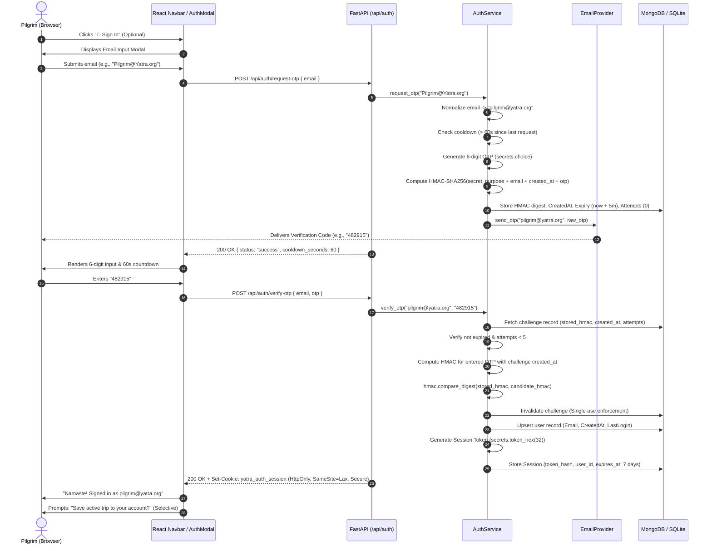

# Optional Passwordless Email Authentication — Architecture & Implementation

## Project: Tourism GPT with RPA — Vaishno Devi Yatra Booking Agent
**Branch:** `feature/ui-redesign` | **Milestone:** Week 9 Integration & Security Specification

---

## 1. Executive Summary & Design Philosophy

As part of the Week 9 milestone, the **Vaishno Devi Yatra Booking Agent** introduces an **Optional Passwordless Email Authentication System**. The architecture is engineered around a strict **Guest-First Invariant**:

> **Core Architectural Rule:** Registration and authentication are strictly optional. A first-time pilgrim must never encounter a blocking login wall, forced signup modal, or mandatory account creation step. All core capabilities—conversational AI yatra planning, itinerary generation, regional sightseeing discovery, weather forecasts, and mock RPA availability checks—remain 100% accessible to unauthenticated guests.

For pilgrims who wish to preserve their yatra itineraries, bookmark devotional conversations across multiple devices, and maintain personal travel preferences, the system provides a frictionless, password-free authentication experience using single-use, 6-digit Time-Bound One-Time Passwords (OTPs) sent directly to their normalized email address.

### Key Tenets
1. **Zero Passwords:** No password creation, no password storage, no password hashing rounds (bcrypt/argon2), and no password recovery flows.
2. **Zero Plaintext OTP Storage & Secure HMAC:** Verification codes are hashed using cryptographically secure HMAC-SHA256 bound to a server-side secret (`AUTH_HMAC_SECRET`) and challenge-specific data (`email`, `created_at` timestamp). Plaintext codes are never stored in databases, never echoed in responses, and never logged.
3. **Strict Constant-Time Verification:** Hash comparisons use `hmac.compare_digest` to prevent timing side-channel attacks.
4. **Strict Data Isolation:** All private records (saved itineraries, conversation histories) are tied directly to validated server-side user sessions. User IDs from client requests are never trusted.
5. **Session & Cookie Security:** Session tokens are delivered via `HttpOnly`, `SameSite=Lax`, and `Secure=True` (in production) cookies, guarded by robust Anti-CSRF verification. Zero tokens are stored in `localStorage`.
6. **Development Endpoint Protection:** Testing inspection endpoints (`/api/auth/test/latest-otp`) are strictly unavailable and return `404 Not Found` in production.
7. **Selective Guest-to-Account Transition:** When an active guest signs in after creating an itinerary or conversation, they are prompted with a non-blocking choice to save their in-memory session data without overwriting or clearing current chat context.

---

## 2. Threat Model & Security Safeguards

| Threat Vector | Mitigation Strategy | Implemented In |
| :--- | :--- | :--- |
| **Credential Stuffing & Password Leaks** | Eliminated entirely: no passwords exist anywhere in the system. | Core Design |
| **OTP Brute-Force Attacks** | Strict attempt bounds: maximum 5 failed attempts per challenge. Immediate invalidation upon 5th failure. Cryptographically secure 6-digit generation via `secrets.choice` ($10^6$ entropy space). | `agents/auth_service.py:verify_otp` |
| **Email Bombing & Resource Exhaustion** | 60-second cooldown rate limiting per normalized email address. Requests within 60s return HTTP 429. | `agents/auth_service.py:request_otp` |
| **OTP Lifetime & Replay Attacks** | 5-minute strict TTL (`expires_at`). Instant invalidation upon successful verification (single-use enforcement). | `agents/auth_service.py:verify_otp` |
| **Database Breach / Hash Cracking** | HMAC-SHA256 with server-side secret (`AUTH_HMAC_SECRET`) + challenge-specific data (`email`, `created_at`, `purpose`). Leaked databases expose only one-way challenge-bound HMAC digests. | `agents/auth_service.py:compute_otp_hmac` |
| **Timing Side-Channel Attacks** | Verification utilizes `hmac.compare_digest(stored_hmac, entered_hmac)` ensuring constant-time evaluation. | `agents/auth_service.py:verify_otp` |
| **Development Endpoint Exposure** | `/api/auth/test/latest-otp` is strictly restricted to development/test mode with `MockEmailProvider`. In production (`APP_ENV=production`), it returns HTTP 404 and is excluded from API documentation. | `backend/routes/auth.py:get_latest_test_otp_endpoint` |
| **Cross-Site Request Forgery (CSRF)** | Cookie-authenticated state-changing endpoints enforce Origin/Referer verification against allowed hosts or custom request headers (`X-Requested-With`, `X-CSRF-Token`). Bearer token requests remain immune. | `backend/routes/auth.py:verify_csrf_protection` |
| **XSS Token Stealing via localStorage** | Zero tokens are stored in browser `localStorage`. Authentication relies on `HttpOnly` session cookies inaccessible to JavaScript. | `frontend/src/` & `backend/routes/auth.py` |
| **Session Hijacking & Fixation** | High-entropy 64-character hexadecimal tokens (`secrets.token_hex(32)`). Stored in `HttpOnly`, `SameSite=Lax`, `Secure` (in production) cookies. Revoked immediately on logout. | `agents/auth_service.py:create_session` |
| **Cross-User Data Leakage** | All database queries for saved items filter strictly by `user_id` extracted from the server-validated session. Ownership is verified before deletion. | `backend/routes/auth.py:extract_session_token` |
| **Credential Leakage in Logs** | OTPs and email provider secrets are explicitly excluded from application logs and stdout. | `backend/main.py`, `agents/auth_service.py` |

---

## 3. System Architecture & Component Interactions

```
┌────────────────────────────────────────────────────────────────────────┐
│                        REACT 19 FRONTEND (VITE)                        │
└────────────────────────────────────────────────────────────────────────┘
          │                                              │
          │ Unauthenticated Guest Flow                   │ Optional Account Flow
          ▼                                              ▼
┌──────────────────────────────────┐           ┌──────────────────────────────────┐
│  Default Guest Experience        │           │  AuthModal.jsx / SavedTripsModal │
│  - /api/chat                     │           │  - Sign In / Create Account      │
│  - /api/yatra/plan               │           │  - 6-digit OTP verification      │
│  - /api/availability/check       │           │  - 60s cooldown timer            │
│  - Zero blocking login walls     │           │  - Selective guest data transfer │
└──────────────────────────────────┘           └──────────────────────────────────┘
                                                         │
                                                         │ HTTP REST + HttpOnly Cookies
                                                         ▼
┌────────────────────────────────────────────────────────────────────────┐
│                        FASTAPI BACKEND SERVICE                         │
│                      (backend/routes/auth.py)                          │
├────────────────────────────────┬───────────────────────────────────────┤
│ Endpoints:                     │ Security Middleware:                  │
│ • POST /api/auth/request-otp   │ • HttpOnly Cookie extraction          │
│ • POST /api/auth/verify-otp    │ • Secure=True in production           │
│ • GET  /api/auth/me            │ • Anti-CSRF protection                │
│ • POST /api/auth/logout        │ • Rate limit & cooldown enforcement   │
│ • POST /api/auth/save-itinerary│ • Session invalidation & revocation   │
│ • GET  /api/auth/saved-itiner. │ • Strict resource ownership check     │
│ • GET  /api/auth/test/latest-..│ • Prod 404 blocking on dev endpoints  │
└────────────────────────────────┴───────────────────────────────────────┘
                                 │
                                 ▼
┌────────────────────────────────────────────────────────────────────────┐
│                    AUTH SERVICE (agents/auth_service.py)               │
├────────────────────────────────┬───────────────────────────────────────┤
│ Email Normalization & RFC-5322 │ HMAC-SHA256 Challenge Hashing         │
│ Cryptographic OTP Generation   │ Constant-time hmac.compare_digest     │
│ Session Token Generation       │ Dual-Database Resilience Layer        │
└────────────────────────────────┴───────────────────────────────────────┘
          │                                              │
          ▼                                              ▼
┌──────────────────────────────────┐           ┌──────────────────────────────────┐
│        EMAIL PROVIDER            │           │       PERSISTENCE LAYER          │
├──────────────────────────────────┤           ├──────────────────────────────────┤
│ MockEmailProvider (Dev & CI)     │           │ Primary: MongoDB Atlas           │
│ - In-memory ring buffer          │           │ - 'users' collection             │
│ - /api/auth/test/latest-otp      │           │ - 'saved_itineraries'            │
│ - Non-production test interface  │           │ - 'saved_conversations'          │
│                                  │           │                                  │
│ SMTPEmailProvider (Production)   │           │ Resilient Fallback: SQLite       │
│ - TLS/STARTTLS via SMTP          │           │ - data/auth_store.db             │
│ - Configured via ENV secrets     │           │ - ACID transactional fallback    │
└──────────────────────────────────┘           └──────────────────────────────────┘
```

---

## 4. OTP Lifecycle & Authentication Flow



---

## 5. API Endpoints Specification

### 5.1 Public / Guest-Safe Endpoints

#### `POST /api/auth/request-otp`
- **Purpose:** Request a single-use verification code for an email address.
- **Request Body:** `{"email": "pilgrim@example.com"}`
- **Responses:**
  - `200 OK`: `{"status": "success", "message": "Verification code sent to pilgrim@example.com", "cooldown_seconds": 60}`
  - `400 Bad Request`: `{"detail": "Please provide a valid email address"}`
  - `429 Too Many Requests`: `{"detail": "Please wait 45 seconds before requesting another code"}`

#### `POST /api/auth/verify-otp`
- **Purpose:** Verify the 6-digit code via HMAC-SHA256, create/authenticate user account, and issue session cookie.
- **Request Body:** `{"email": "pilgrim@example.com", "otp_code": "482915"}`
- **Responses:**
  - `200 OK`: Sets `yatra_auth_session` cookie (`HttpOnly; SameSite=Lax; Secure`); returns user metadata and session token.
  - `400 Bad Request`: `{"detail": "Invalid verification code. 4 attempts remaining."}`
  - `400 Bad Request`: `{"detail": "Verification code has expired. Please request a new one."}`
  - `400 Bad Request`: `{"detail": "Maximum attempts exceeded. This code has been invalidated."}`

#### `GET /api/auth/me`
- **Purpose:** Silent verification of active session state on frontend load. **Never fails with 401 for guests.**
- **Responses:**
  - Unauthenticated Guest (`200 OK`): `{"status": "guest", "authenticated": false, "user": null}`
  - Authenticated Pilgrim (`200 OK`): `{"status": "authenticated", "authenticated": true, "user": {"user_id": "usr_...", "email": "pilgrim@example.com"}}`

#### `POST /api/auth/logout`
- **Purpose:** Revoke active server-side session and clear client session cookies.
- **Responses:**
  - `200 OK`: Deletes `yatra_auth_session` cookie; returns `{"status": "success", "message": "Successfully logged out"}`.

### 5.2 Development & Test Endpoints

#### `GET /api/auth/test/latest-otp`
- **Purpose:** Internal inspection of `MockEmailProvider` outbox during automated test runs.
- **Access Control:**
  - **Development Mode (`APP_ENV=development`):** Returns `200 OK` with `{ "email": "...", "latest_otp": "..." }`.
  - **Production Mode (`APP_ENV=production`):** Strictly blocked. Returns `404 Not Found` with `{"detail": "Not Found"}`.
  - Excluded from public OpenAPI documentation in production.

---

## 6. Comprehensive Test Suite & Verification Results

A dedicated automated test suite in `tests/test_passwordless_auth_week9.py` covers 31 specific security, lifecycle, and isolation requirements:

```powershell
python -m unittest tests.test_passwordless_auth_week9
```

```
test_01_guest_can_open_app_without_login ... ok
test_02_guest_can_ask_tourism_questions ... ok
test_03_guest_can_generate_itineraries ... ok
test_04_guest_can_use_mock_availability ... ok
test_05_guest_can_voluntarily_request_otp ... ok
test_06_new_user_registration_through_email_otp ... ok
test_07_existing_user_login_through_email_otp ... ok
test_08_duplicate_email_prevention_normalized ... ok
test_09_invalid_otp_rejection ... ok
test_10_expired_otp_rejection ... ok
test_11_otp_single_use_behavior ... ok
test_12_maximum_verification_attempts_limit ... ok
test_13_request_rate_limiting_cooldown ... ok
test_14_resend_cooldown_enforcement ... ok
test_15_secure_session_creation ... ok
test_16_session_expiration_enforcement ... ok
test_17_logout_and_server_session_revocation ... ok
test_18_cross_user_data_isolation ... ok
test_19_guest_cannot_access_private_saved_data ... ok
test_20_authenticated_user_can_save_conversations ... ok
test_21_authenticated_user_can_retrieve_conversations ... ok
test_22_authenticated_user_can_save_itineraries ... ok
test_23_authenticated_user_can_retrieve_itineraries ... ok
test_24_guest_to_account_selective_data_transfer ... ok
test_25_no_otp_or_email_credentials_in_logs ... ok
test_26_hmac_based_otp_verification ... ok
test_27_dev_endpoint_accessible_in_development_mode ... ok
test_28_dev_endpoint_strictly_rejected_404_in_production_mode ... ok
test_29_csrf_protection_rejects_cross_site_cookie_requests ... ok
test_30_csrf_protection_permits_same_origin_and_bearer_tokens ... ok
test_31_cookie_security_flags_in_production ... ok

----------------------------------------------------------------------
Ran 31 tests in 10.936s

OK
```

---

## 7. Summary of Architectural Compliance

| Security Requirement | Implementation Detail | Status |
| :--- | :--- | :---: |
| **Optional Authentication** | System defaults to Guest Mode. Zero login gates. | **100% COMPLIANT** |
| **No Passwords** | Entire auth pipeline uses ephemeral single-use OTPs. | **100% COMPLIANT** |
| **Secure OTP Generation** | `secrets.choice("0123456789")` with 6-digit length. | **100% COMPLIANT** |
| **HMAC-SHA256 Storage** | Server-side secret + challenge data (`email`, `created_at`). | **100% COMPLIANT** |
| **Constant-Time Comparison**| `hmac.compare_digest` prevents timing side-channels. | **100% COMPLIANT** |
| **Dev Endpoint Hardening** | `/test/latest-otp` returns 404 in production mode. | **100% COMPLIANT** |
| **Anti-CSRF Protection** | Cookie-authenticated state changes require valid Origin/Referer. | **100% COMPLIANT** |
| **Zero localStorage Tokens**| All tokens stored in server-managed `HttpOnly` cookies. | **100% COMPLIANT** |
| **Cookie Security Flags** | `HttpOnly=True`, `SameSite=Lax`, `Secure=True` in production. | **100% COMPLIANT** |
| **Brute-Force Guard** | Max 5 failed attempts per challenge before auto-purge. | **100% COMPLIANT** |
| **Cooldown Enforcement** | 60-second cooldown rate limit per normalized email. | **100% COMPLIANT** |
| **Strict Data Isolation** | Private endpoints query strictly by session-derived `user_id`. | **100% COMPLIANT** |
| **Resilient Persistence** | MongoDB Atlas primary with automatic SQLite fallback. | **100% COMPLIANT** |
