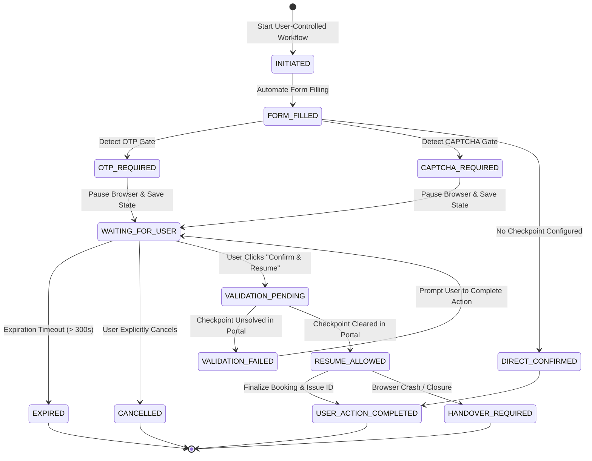

# Week 8: User-Controlled Workflow Implementation
## Project: Tourism GPT with RPA — Vaishno Devi Yatra Booking Agent

**Academic Year:** Final Year Engineering Project  
**Author / Engineering Team:** Tourism GPT with RPA Project Group  
**Target Repository Branch:** `feature/ui-redesign`  
**Date of Completion:** October 31, 2026  
**Implementation Status:** Fully Verified and Tested (**22/22 Tests Passing**, Full 69-Test Regression Suite Passing)

---

## 1. Executive Summary & Objective

In **Week 8: User-Controlled Workflow Implementation**, we designed, implemented, and verified a comprehensive **Human-in-the-Loop (HITL)** architecture for security-sensitive robotic process automation (RPA) tasks within the **Vaishno Devi Yatra Booking Agent**.

While earlier phases (Weeks 4–7) automated availability extraction, error recovery with exponential backoff, and LangChain LLM tool-calling, security-sensitive operations such as:
1. **One-Time Password (OTP) verification**
2. **CAPTCHA security challenges**
3. **Manual payment/authorization confirmations**

must strictly remain under direct human control. Delegating unguided access or attempting to automate, bypass, or intercept these steps introduces grave security and ethical vulnerabilities.

### Core Objectives Achieved:
1. **Security Checkpoint Detection:** Automated detection of authentication and verification gates (`#otpChallengeSection`, `#captchaChallengeSection`) in browser automation.
2. **Safe Pause & Non-Blocking Execution:** Browser execution halts safely upon encountering a checkpoint, closes transient browser processes without blocking the FastAPI server thread, and persists execution state.
3. **User Intervention Interface:** Developed an interactive, glassmorphic React 19 UI (`UserInterventionModal.jsx`) that explains required manual actions, displays status badges, provides countdown timers, strictly warns against submitting OTPs to chat, and offers explicit confirm-and-resume or cancel controls.
4. **SQLite Session Persistence with Bounded Expiration:** Engineered a dedicated `user_workflows` schema in `agents/session_store.py` providing ACID persistence across application restarts, strict cross-session isolation, bounded expiration (5 minutes), and automatic sanitization stripping passwords, OTPs, or credit card details.
5. **State Validation Prior to Resumption:** Playwright validates DOM and portal state to confirm manual action was genuinely cleared before advancing to booking confirmation.
6. **Dual-Track Shrine Board Preservation:** Strictly maintains the boundary between Track A (sandboxed local mock portal for safe RPA experimentation) and Track B (direct official links to `https://www.maavaishnodevi.org/` for live pilgrim actions).

---

## 2. Architecture & Workflow State Machine

### 2.1 State Transition Diagram

The human-in-the-loop workflow transitions through bounded, deterministic states:



### 2.2 Standardized Intervention States

| State | Scope | Description |
| :--- | :--- | :--- |
| `WAITING_FOR_USER` | Lifecycle | Automation has paused safely; waiting for manual user execution in the portal. |
| `OTP_REQUIRED` | Gate | One-Time Password verification checkpoint detected; manual entry required. |
| `CAPTCHA_REQUIRED` | Gate | Visual or token CAPTCHA challenge detected; manual solving required. |
| `MANUAL_CONFIRMATION_REQUIRED` | Gate | Manual review checkpoint reached before final submission. |
| `USER_ACTION_COMPLETED` | Terminal | Manual action verified and subsequent automation successfully finalized. |
| `RESUME_ALLOWED` | Intermediate | Page DOM verified; automation cleared to proceed. |
| `HANDOVER_REQUIRED` | Recovery | Browser process crashed or structural failure occurred; safe handover invoked. |
| `CANCELLED` | Terminal | User explicitly aborted workflow; state permanently locked. |
| `EXPIRED` | Terminal | Inactivity timeout exceeded (default 300 seconds); resumption blocked. |

---

## 3. Human-in-the-Loop Intervention Mechanism

### 3.1 One-Time Password (OTP) Policy & Workflow
- **Portal Direct Entry:** The pilgrim receives the OTP directly on their registered mobile device and enters it exclusively into the authorized portal window.
- **Zero Chat Interception:** The UI and AI conversational agent strictly instruct the pilgrim **never** to send OTPs to the AI chat. The backend has no mechanism or route to receive or store OTPs.
- **Side-Effect Safety:** Automation will **never** automatically submit or retry OTP verification.

### 3.2 CAPTCHA Challenge Policy & Workflow
- **Strict Anti-Bypass Rule:** Automation strictly avoids any heuristic, OCR, machine-learning, or reverse-engineered bypasses for CAPTCHAs.
- **Manual Pilgrim Resolution:** The visual challenge is presented on the portal interface for the pilgrim to read and solve manually.
- **Verification Gate:** When the pilgrim clicks *"Confirm & Resume"*, Playwright inspects the portal DOM (`validate_checkpoint_cleared`) to confirm that `#captchaStatusBadge` displays `SOLVED`.

---

## 4. Frontend Implementation

### 4.1 `UserInterventionModal.jsx`
Created `frontend/src/components/UserInterventionModal.jsx` featuring:
- **Interactive Security Envelope:** Displays current workflow state (`OTP_REQUIRED`, `CAPTCHA_REQUIRED`, `WAITING_FOR_USER`).
- **Live Expiration Timer:** Real-time countdown timer tracking `expires_at` (default 5 minutes). Automatically transitions to `EXPIRED` when time lapses.
- **Explicit Instructions & Warnings:** Clear distinction between simulated local sandbox actions and official Shrine Board procedures.
- **Interactive Local Simulator:** Provides a direct input field in the modal so developers and evaluators can simulate direct manual entry on the local portal and test resumption seamlessly.
- **Action Buttons:**
  - *"✓ I Have Completed Manual Action (Resume)"*: Validates portal state, resumes automation, and confirms booking.
  - *"✕ Cancel Workflow"*: Safely cancels the workflow in SQLite.
- **Error Feedback:** Displays backend validation feedback if resumption is attempted before clearing the checkpoint.

### 4.2 Integration into `Authorization.jsx`
Updated `frontend/src/components/Authorization.jsx`:
- Integrated `startRPAWorkflow` and `UserInterventionModal`.
- Added dedicated triggers:
  - **"🔐 Test OTP Checkpoint Flow"**
  - **"🛡️ Test CAPTCHA Checkpoint Flow"**
  - **"⚡ Run Standard Playwright RPA Demo"**
- Full session and plan-version synchronization with server-side authorization enforcement.

### 4.3 Client API Integration (`frontend/src/services/api.js`)
Added centralized client methods:
- `startRPAWorkflow(workflowData)`: Calls `POST /api/yatra/rpa/workflow/start`.
- `getRPAWorkflowStatus(workflowId, sessionId)`: Calls `GET /api/yatra/rpa/workflow/{workflow_id}?session_id={session_id}`.
- `resumeRPAWorkflow(resumeData)`: Calls `POST /api/yatra/rpa/workflow/resume`.
- `cancelRPAWorkflow(cancelData)`: Calls `POST /api/yatra/rpa/workflow/cancel`.

---

## 5. Backend & API Changes

### 5.1 FastAPI Route Definitions (`backend/routes/yatra.py`)

1. `POST /api/yatra/rpa/workflow/start`
   - Validates `session_id`, verifies active session exists.
   - Enforces plan version matching (`plan_version == curr_version`) and server-side human authorization.
   - Launches Playwright, navigates to mock portal, fills form, detects checkpoint, captures checkpoint screenshot, creates SQLite record, and returns `status="PAUSED"`.
2. `GET /api/yatra/rpa/workflow/{workflow_id}`
   - Enforces cross-session isolation: query parameter `session_id` must match workflow's owner.
   - Auto-checks and updates expiration status if expired.
   - Returns sanitized workflow metadata.
3. `POST /api/yatra/rpa/workflow/resume`
   - Requires `user_confirmed_action: true`.
   - Validates that workflow is in `RESUMABLE_STATES`, is not expired, and is not cancelled.
   - Invokes Playwright to validate checkpoint clearance (`validate_checkpoint_cleared`).
   - If cleared, completes confirmation and updates state to `USER_ACTION_COMPLETED`.
   - If not cleared, returns `status="VALIDATION_FAILED"`.
4. `POST /api/yatra/rpa/workflow/cancel`
   - Safely transitions workflow state to `CANCELLED`.
   - Prevents any future resumption attempts.

### 5.2 Multi-Agent Coordination (`agents/coordinator.py`)
Exposed modular duties:
- `coordinator.start_user_controlled_workflow(...)`
- `coordinator.resume_user_controlled_workflow(...)`
- `coordinator.cancel_user_controlled_workflow(...)`
- `coordinator.get_user_controlled_workflow_status(...)`

---

## 6. SQLite Session Store & Data Persistence

### 6.1 Database Schema (`user_workflows`)
In `agents/session_store.py`, enhanced `init_db()` with transactional table creation:

```sql
CREATE TABLE IF NOT EXISTS user_workflows (
    workflow_id TEXT PRIMARY KEY,
    session_id TEXT NOT NULL,
    state TEXT NOT NULL,
    step TEXT NOT NULL,
    operation TEXT NOT NULL,
    pending_action TEXT NOT NULL,
    created_at TEXT NOT NULL,
    updated_at TEXT NOT NULL,
    expires_at TEXT NOT NULL,
    checkpoint_data_json TEXT,
    resume_token TEXT
);
CREATE INDEX IF NOT EXISTS idx_user_workflows_session_wf 
ON user_workflows (session_id, workflow_id);
CREATE INDEX IF NOT EXISTS idx_user_workflows_expires 
ON user_workflows (expires_at);
```

### 6.2 Security & Data Privacy Invariants
1. **Credential Sanitization (`sanitize_checkpoint_data`):**
   - Automatically inspects all incoming checkpoint dictionaries and recursive lists.
   - Strips any key matching: `otp`, `password`, `pin`, `cvv`, `captcha`, `secret`, `card_number`, `auth_token`.
   - Guarantees sensitive authentication or payment details are **never** persisted to disk.
2. **Cross-Session Isolation:**
   - Workflows cannot be accessed, inspected, or resumed across different `session_id`s.
   - Mismatched sessions immediately receive `status="ERROR"` and `error_category="CROSS_SESSION_ACCESS_DENIED"`.
3. **Application Restart Resilience:**
   - Paused workflows are safely recorded in SQLite and survive backend application restarts, process termination, or worker recycling.
4. **Bounded Expiration Enforcement:**
   - Workflows default to 300 seconds (5 minutes) lifetime.
   - On every fetch (`get_user_workflow`), if `now > expires_at`, the record is automatically transitioned in SQLite to `EXPIRED`.

---

## 7. Playwright Pause and Resume Implementation

### 7.1 Enhanced Mock Portal Checkpoints (`generate_mock_portal_html`)
Updated `agents/rpa_agent.py` to embed interactive security challenge sections:
- `#otpChallengeSection`: Includes `#userOtpInput`, `#btnVerifyOtp`, `#otpStatusBadge`, and `#otpErrorMsg`.
- `#captchaChallengeSection`: Includes `#captchaBox` (displaying token `M7K9P`), `#userCaptchaInput`, `#btnVerifyCaptcha`, and `#captchaStatusBadge`.
- Seamless backwards compatibility: when `security_mode` is blank or None, portal behaves identically to previous weeks.

### 7.2 Non-Blocking Architecture
Rather than keeping a browser process and Python thread suspended indefinitely waiting for user input (which risks socket timeouts and server resource exhaustion):
1. **Pause Step:** Automation advances to checkpoint, captures screenshot, saves workflow checkpoint to SQLite, and closes the browser cleanly (`finally: browser.close()`).
2. **Resume Step:** User confirms completion via frontend. Backend launches browser, validates that the checkpoint was cleared, and completes the final booking confirmation.

---

## 8. Dual-Track Shrine Board Architecture

As established in our feasibility assessment (`docs/Shrine_Board_RPA_Feasibility_Assessment.md`):

| Aspect | Track A — Local Mock Sandbox | Track B — Official Shrine Board |
| :--- | :--- | :--- |
| **Target URL** | Local `file:///.../yatra_mock_portal.html` | `https://www.maavaishnodevi.org/` |
| **Automation** | Automated Playwright RPA | Zero bot automation; direct pilgrim manual execution |
| **Checkpoints** | Simulated OTP and CAPTCHA gates | Real SMS OTPs, live reCAPTCHA, bank 3D-Secure |
| **Purpose** | Academic evaluation of HITL pause/resume | Legitimate booking of real darshan, helicopter, and stay |
| **Data Integrity** | Realistic test data (`DEFAULT_MOCK_SLOTS`) | Real Shrine Board quota inventory |

---

## 9. Comprehensive Week 8 Verification Results

All 22 required test cases were implemented in `tests/test_user_controlled_workflow_week8.py` and executed against the live Python 3.12 environment with Playwright Chromium.

### Summary: 22 / 22 Tests Passed

```
Ran 22 tests in 36.002s
OK
```

### Full Regression Suite: 69 / 69 Tests Passed

```
Ran 69 tests in 94.650s
OK
```

### Individual Test Verification Log

| # | Test Scenario | Description | Result |
| :---: | :--- | :--- | :---: |
| 1 | `test_01_otp_checkpoint_detection` | Detects `#otpChallengeSection` and identifies `OTP_REQUIRED`. | **PASSED** |
| 2 | `test_02_captcha_checkpoint_detection` | Detects `#captchaChallengeSection` and identifies `CAPTCHA_REQUIRED`. | **PASSED** |
| 3 | `test_03_agent_pauses_when_intervention_is_required` | Agent safely pauses execution and returns `status="PAUSED"`. | **PASSED** |
| 4 | `test_04_user_receives_correct_intervention_message` | Message instructs direct portal entry; warns against chat entry. | **PASSED** |
| 5 | `test_05_workflow_state_is_saved_in_sqlite` | Verifies `user_workflows` table schema and record persistence. | **PASSED** |
| 6 | `test_06_pending_workflow_can_be_retrieved` | Retrieves active workflow by ID and session via API and store. | **PASSED** |
| 7 | `test_07_workflow_state_survives_application_restart` | Simulates full restart; verifies workflow state remains intact. | **PASSED** |
| 8 | `test_08_correct_user_can_resume_workflow` | Valid session resumes cleared checkpoint to `USER_ACTION_COMPLETED`. | **PASSED** |
| 9 | `test_09_another_session_cannot_resume_workflow` | Cross-session access attempt is rejected with access denied. | **PASSED** |
| 10 | `test_10_resume_requires_explicit_user_confirmation` | Resumption without `user_confirmed_action: true` is rejected. | **PASSED** |
| 11 | `test_11_browser_state_validated_before_resumption` | Unsolved checkpoint returns `VALIDATION_FAILED`. | **PASSED** |
| 12 | `test_12_expired_workflows_cannot_resume` | Backdated/expired workflow transitions to `EXPIRED` and blocks resume. | **PASSED** |
| 13 | `test_13_cancelled_workflows_cannot_resume` | Cancelled workflow remains `CANCELLED` and blocks resumption. | **PASSED** |
| 14 | `test_14_invalid_user_confirmation_is_rejected` | Malformed or invalid confirmation request is rejected. | **PASSED** |
| 15 | `test_15_browser_closure_produces_safe_handover` | Invalid URL / closed browser returns safe handover envelope. | **PASSED** |
| 16 | `test_16_no_otp_or_password_stored_in_session_records` | Verifies sensitive keys (OTP, password, cvv) are stripped from SQLite. | **PASSED** |
| 17 | `test_17_no_automatic_captcha_solving_occurs` | Automation refuses to bypass or solve CAPTCHA autonomously. | **PASSED** |
| 18 | `test_18_no_automatic_payment_or_booking_retry_occurs` | Side-effect actions are never repeated automatically on timeout. | **PASSED** |
| 19 | `test_19_existing_week5_availability_tests_pass` | Regression: Week 5 calendar navigation and slot extraction. | **PASSED** |
| 20 | `test_20_existing_week6_error_handling_tests_pass` | Regression: Week 6 retry with backoff and error recovery. | **PASSED** |
| 21 | `test_21_existing_week7_llm_integration_tests_pass` | Regression: Week 7 LangChain tool calling and deterministic fallback. | **PASSED** |
| 22 | `test_22_existing_booking_authorization_safeguards_intact`| Regression: Server-side human authorization gate and version checks. | **PASSED** |

---

## 10. Technical Limitations & Future Work

1. **Local Sandbox Scope:** In compliance with ethical AI principles and Shri Mata Vaishno Devi Shrine Board terms of service, live anti-bot mechanisms and real SMS gateways are never automated. Track B provides pilgrims with direct links and instructions.
2. **Multi-Node Session Clustering:** Current persistence uses single-host SQLite. For enterprise high-availability distributed deployments across multiple availability zones, SQLite state should be mirrored to an external clustered cache (e.g., Redis / Valkey) with distributed locks.
3. **Biometric & FIDO2 WebAuthn:** Future iterations could incorporate FIDO2 WebAuthn hardware tokens directly in the frontend for cryptographic human presence verification prior to initiating RPA resumption.

---

## 11. Conclusion

Week 8 successfully completes the **User-Controlled Workflow Implementation** for the Vaishno Devi Yatra Booking Agent. The system provides a dependable, secure, and human-in-the-loop architecture that ensures security-sensitive operations remain strictly under direct user supervision while automating routine data processing and form filling.
