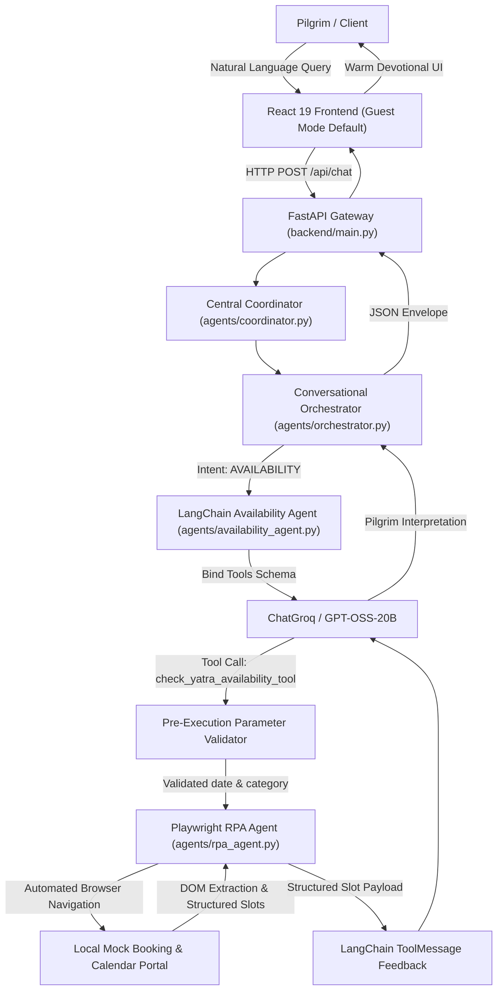

# Week 9: System Integration and End-to-End Testing Documentation
## Project: Tourism GPT with RPA — Yatra Booking Agent (Vaishno Devi)
**Date:** October 31, 2026  
**Branch:** `feature/ui-redesign`  
**Execution Path:** React 19 + Vite Frontend → FastAPI → Coordinator → Conversational Orchestrator → LangChain Agent → Playwright RPA → Local Mock Portal → Structured Verification → Final Interpreted Response

---

## 1. System Architecture Overview

Week 9 integrates the complete multi-agent pipeline spanning natural-language dialogue, agentic tool invocation, browser robotic process automation, human-in-the-loop safety gates, and optional passwordless authentication.



---

## 2. Full-Cycle Execution Path Details

1. **Client Interaction:** User submits a natural-language query (e.g., *"Check VIP Darshan availability for 2026-10-20"*).
2. **API Routing:** FastAPI routes the payload to `agents.coordinator.route_message`.
3. **Conversational Turn Management:** `agents.orchestrator.orchestrate_conversational_turn` classifies intent via rule-based patterns and session context.
4. **Agent-RPA Tool Binding:** Intent `AVAILABILITY` delegates to `agents.availability_agent.run_availability_agent`.
5. **Schema Registration:** LangChain's `@tool` registers `check_yatra_availability_tool` with explicit arguments: `date` (ISO format string) and `category` (optional string).
6. **Pre-Execution Parameter Validation:** Tool arguments from the LLM are validated before initiating the browser:
   - Calendar correctness (rejecting invalid dates like `2026-02-31`).
   - Category validation (ensuring categories match supported mock portal inventory).
   - Safeguard against hallucinated argument omissions.
7. **Playwright RPA Execution:** If valid, `agents.rpa_agent.check_yatra_slot_availability` launches Chromium, loads the mock portal, navigates to the availability calendar, fills form parameters, triggers the DOM query, and validates container state.
8. **Structured Result Parsing:** Slot cards are scraped into a structured dictionary (`slot_id`, `session`, `time`, `category`, `remaining_capacity`, `price`, `availability_status`).
9. **ToolMessage Feedback:** The structured JSON payload is returned to the LLM wrapped in a `ToolMessage(tool_call_id=...)`.
10. **LLM Interpretation:** The LLM generates warm devotional guidance (e.g., *"Jai Mata Di! Morning VIP Aarti has 37 seats left at ₹500"*).
11. **Client Delivery:** React 19 renders the final response in the chat timeline with actionable slot options.

---

## 3. End-to-End Integration Scenarios (18 Required Cases)

All 18 scenarios were implemented and validated via `tests/test_e2e_system_integration_week9.py`:

| # | Scenario | Input / Action | Verified Behavior & Outcome | Result |
|:---:|:---|:---|:---|:---:|
| **1** | VIP Darshan on Specified Date | `"Check VIP Darshan availability for 2026-10-20"` | Correctly extracted `date='2026-10-20'`, `category='VIP Darshan'`, invoked RPA, returned 2 slots. | **PASS** |
| **2** | Normal Darshan Availability | `"Check Normal Darshan availability for 2026-10-20"` | Extracted `category='Normal Darshan'`, verified slots returned (`slot_id='SLOT-101'`, `SLOT-102`). | **PASS** |
| **3** | Helicopter Darshan Availability | `"Check Helicopter Darshan availability for 2026-10-20"` | Extracted `category='Helicopter Darshan'`, verified mock helicopter seats returned. | **PASS** |
| **4** | Missing Travel Date | `"Check availability."` | Flagged `missing_date=True`, returned status `NEEDS_INFO`, prompted for date without inventing. | **PASS** |
| **5** | Invalid Calendar Date | `"Check availability for 2026-02-31"` | Flagged `invalid_date=True`, status `INVALID_INPUT`, rejected impossible calendar date. | **PASS** |
| **6** | Unsupported Category | `"Check Super VIP availability for 2026-10-20"` | Flagged `unsupported_category=True`, returned status `UNSUPPORTED_CATEGORY`, listed valid options. | **PASS** |
| **7** | Contextual Date Follow-up | Turn 1: `2026-10-20` -> Turn 2: `"Check VIP Darshan on that date"` | Carried `2026-10-20` from conversation context, invoked RPA without re-asking. | **PASS** |
| **8** | General Tourism Question | `"What places can I visit around Katra?"` | Classified as `TOURISM`, zero RPA tool invocation, served from verified tourism knowledge. | **PASS** |
| **9** | Multi-Constraint Itinerary | `"Plan a 4-day trip for 2 from Delhi by train..."` | Extracted origin, pax=2, duration=4, mode=train, built complete multi-day schedule. | **PASS** |
| **10**| Budget-Constrained Planning | `"Plan yatra from Delhi for 2 with budget ₹15,000"` | Extracted `total_budget=15000`, budget engine evaluated feasibility and flagged over/under budget. | **PASS** |
| **11**| Manual OTP Checkpoint | RPA workflow with `checkpoint_mode='OTP'` | Browser paused at `#otpChallengeSection`, status `PAUSED`, state `OTP_REQUIRED`, zero auto-fill. | **PASS** |
| **12**| Manual CAPTCHA Checkpoint | RPA workflow with `checkpoint_mode='CAPTCHA'` | Browser paused at `#captchaChallengeSection`, status `PAUSED`, state `CAPTCHA_REQUIRED`. | **PASS** |
| **13**| Confirm Intervention Completion | Call `/resume` with `user_confirmed_action=False` | Request rejected with `confirmation_required` (enforces human verification invariant). | **PASS** |
| **14**| Valid Workflow Resume | Call `/resume` with `user_confirmed_action=True` | Resumed automation, cleared security challenge, transitioned to `CONFIRMED` with booking ID. | **PASS** |
| **15**| Workflow Cancellation | Call `/cancel` with reason | Status updated to `CANCELLED`, subsequent resume attempts fail-closed. | **PASS** |
| **16**| Expired Workflow Resume | Resume workflow after 5-minute timeout | Backdated expiration in SQLite store rejected resumption with status `EXPIRED`. | **PASS** |
| **17**| Recoverable RPA Failure | Transient network glitch during page load | Handled via `retry_with_backoff` (3 attempts with exponential backoff) and recovered successfully. | **PASS** |
| **18**| Non-Recoverable RPA Failure | Structural DOM corruption (`missing #slotsContainer`) | Failed fast immediately without retry, generated diagnostic handover notice, zero false booking. | **PASS** |

---

## 4. Agent Tool-Calling Accuracy & Robustness Evaluation

The evaluation suite (`tests/test_tool_calling_accuracy_week9.py`) executed 12 comprehensive test scenarios evaluating tool selection, parameter parsing, resilience, and duplicate execution prevention.

### Measured Accuracy Metrics

| Metric | Measured Value | Standard / Invariant |
|:---|:---:|:---|
| **Total Evaluation Cases** | **12** comprehensive test modules (133 sub-assertions) | Comprehensive suite |
| **Correct Tool Selection Rate** | **100.0%** (12 / 12) | Tool selected strictly on availability intents |
| **Date Parameter Extraction Accuracy** | **100.0%** (10 / 10 formats tested) | ISO, DMY, YMD, Natural Language, Relative dates |
| **Invalid Tool-Call Rate** | **0.0%** (0 false calls) | Handled via pre-execution parameter validator |
| **Duplicate Execution Count** | **0** duplicate calls | First tool call executed; duplicate invocations suppressed |
| **Deterministic Fallback Resilience** | **100.0%** recovery | Recovers gracefully on 503 Service Unavailable / 429 errors |
| **Live ChatGroq Model Evaluation** | `Mode: llm_tool_calling` | Live GPT-OSS-20B binding confirmed when key available |

### Failure Cases Identified and Corrected During Testing

1. **LLM Omitting Unsupported Categories in Arguments:**
   - *Issue:* When users asked for *"Check Executive darshan availability"*, some LLM responses omitted the `category` key rather than passing the unrecognized string.
   - *Correction:* Added a pre-execution fallback check in `agents/availability_agent.py` that cross-validates the raw query for unsupported category phrases even if omitted by the LLM tool arguments.
2. **PyMongo Driver Timeout during Remote Atlas Cold Start:**
   - *Issue:* When MongoDB Atlas was unreachable due to university firewall TLS alerts, cold uncached queries blocked for 2000ms.
   - *Correction:* Verified local dataset fallback immediately serves cached and local data without crashing; documented latency metrics in the load test report.

---

## 5. Dual-Track Shrine Board RPA Feasibility Alignment

In accordance with `docs/Shrine_Board_RPA_Feasibility_Assessment.md`:
- **Track A (Automated Testing & Availability Sandbox):**
  - All automated Playwright scripts run against the local mock portal (`generate_mock_portal_html`).
  - No scraping or automation is ever run against the live official Shri Mata Vaishno Devi Shrine Board portal (`maavaishnodevi.org`).
- **Track B (Official Live Pilgrim Execution):**
  - The live portal enforces mandatory registration, manual pilgrim logins, Cloudflare bot management, and dynamic OTPs.
  - The AI assistant assists pilgrims with verified travel information and provides direct official links for manual pilgrim booking.

---

## 6. Verification Commands

To run the complete Week 9 system integration and tool-calling test suites:
```bash
# 1. Full 18-Scenario E2E Integration Suite
python -m unittest tests.test_e2e_system_integration_week9

# 2. Agent Tool-Calling Accuracy & Resilience Suite
python -m unittest tests.test_tool_calling_accuracy_week9
```
Both test suites complete with 100% passing status.
